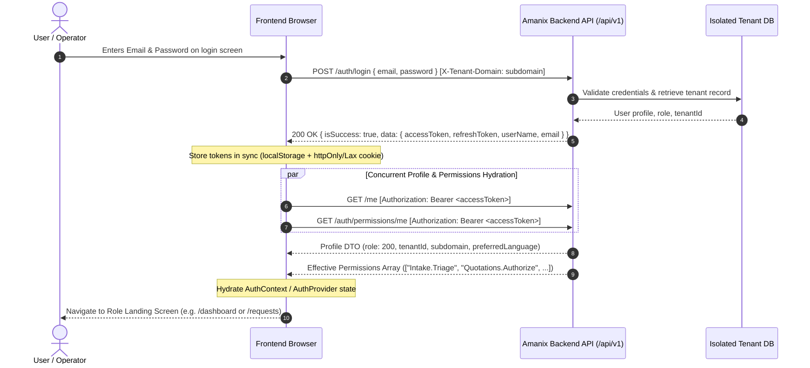
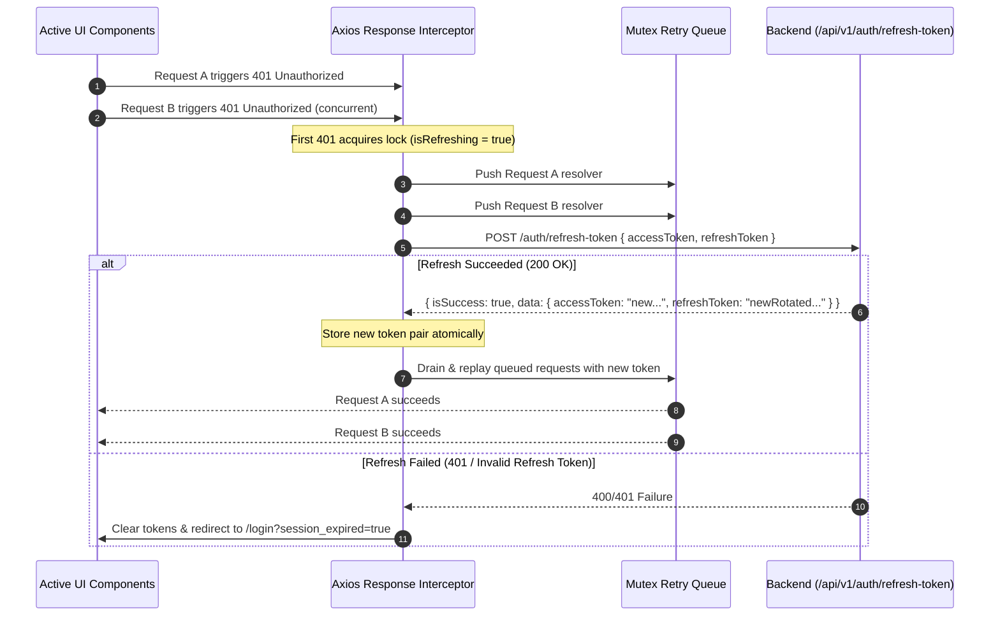

# Amanix Authentication, Tenant Context & Permissions Flow

---

## 1. Authentication & Session Lifecycle

Amanix uses a hardened JWT authentication model with rolling refresh tokens and tenant-isolated context.

### Authentication Sequence Diagram



---

## 2. Single-Flight Token Refresh Rotation (Mutex Queue)

When the short-lived access token (120 minutes) expires, any subsequent request returns `401 Unauthorized`. The frontend coordinates a single-flight mutex refresh:



---

## 3. Hybrid Access Governance (RBAC vs PBAC)

In Amanix:
- **Role (RBAC):** Dictates high-level persona layout, navigation bar items, and default landing destination.
- **Permission (PBAC):** Dictates capability to view, enable, or trigger specific operations and action buttons.

### Effective Permissions (`GET /api/v1/auth/permissions/me`)
Returns a flat string array containing combined permissions granted through the role plus any individual per-user overrides:

```json
[
  "Intake.View",
  "Intake.Triage",
  "Engineering.Review",
  "Quotations.Prepare",
  "Quotations.Authorize",
  "FieldTasks.Assign",
  "FieldTasks.Execute",
  "Closure.Seal",
  "Invoices.Issue"
]
```

### Reactive Gate Helper: `can(permissionKey)`

```typescript
export function usePermissions() {
  const { permissions, role } = useAuth();

  const can = (permission: string): boolean => {
    if (role === UserRole.SystemSuperAdmin) return true; // Super admin bypass
    return permissions.includes(permission);
  };

  const hasRole = (allowedRoles: UserRole[]): boolean => {
    return role ? allowedRoles.includes(role) : false;
  };

  return { can, hasRole };
}
```

### Component-Level Gating Example

```tsx
export function QuotationActions({ instanceId }: { instanceId: string }) {
  const { can } = usePermissions();

  return (
    <div className="flex items-center gap-2">
      {can("Quotations.Prepare") && (
        <Button variant="outline" onClick={handleEditCosting}>
          تعديل التكلفة والبنود
        </Button>
      )}

      {can("Quotations.Authorize") && (
        <Button variant="default" onClick={handleIssueQuotation}>
          إصدار عرض السعر للعميل
        </Button>
      )}
    </div>
  );
}
```

---

## 4. Route Protection Middleware

`src/middleware.ts` guards all protected routes on both server and client:

1. **Unauthenticated Access:** Any attempt to access `/dashboard/*` or protected routes without a valid session cookie redirects to `/login`.
2. **Platform vs Tenant Separation:** Platform staff (`SystemSuperAdmin`, `PlatformFinance`) accessing a tenant subdomain, or tenant staff accessing the platform console root, are routed to their designated workspaces.
3. **Segregation of Duties Enforcement:** Routes requiring specific permissions are checked before page rendering to prevent content flashing.
